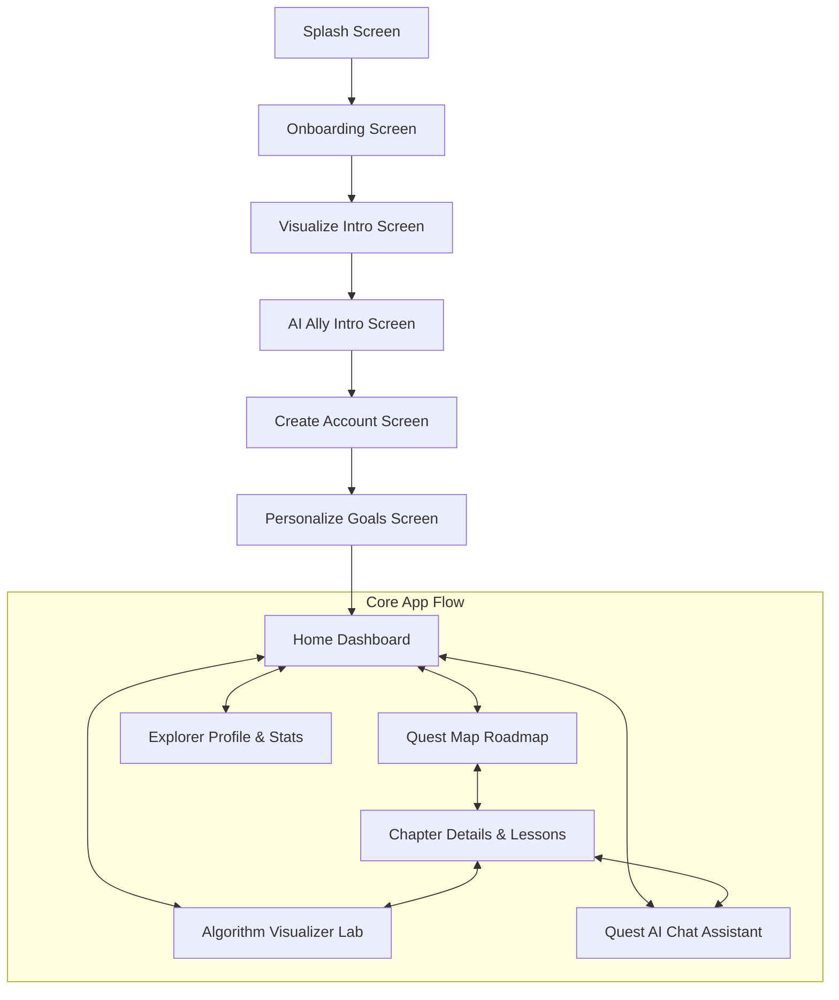

# AlgoQuest 🚀  
### AI-Powered Data Structures & Algorithms (DSA) Learning & Interactive Visualization App

[](https://developer.android.com/)
[](https://kotlinlang.org/)
[](https://developer.android.com/jetpack/compose)
[](LICENSE)

---

## 🌟 Overview

**AlgoQuest** is a modern, gamified Android application engineered to make Data Structures & Algorithms intuitive, interactive, and engaging. Built natively with **Jetpack Compose** and **Kotlin**, AlgoQuest combines step-by-step algorithm execution visualization with an AI-powered tutor (**Quest AI**) to help learners master complex computer science concepts through hands-on practice.

---

## ✨ Key Features

### 1. 🧪 Interactive Algorithm Visualizer Lab
* **Live Step-by-Step Execution**: Step forward, backward, auto-play, pause, and reset algorithm execution traces.
* **Dynamic Array & Pointer Visualization**: Visual representation of array elements with color-coded pointers (`low`, `mid`, `high`), value comparisons, and range elimination.
* **Code & Pseudocode Highlight**: Real-time line highlighting synchronized with visual array state.
* **Time & Space Complexity Breakdown**: Clear metric cards explaining $O(\log N)$ time complexity and $O(1)$ space complexity.
* **Direct AI Assistance**: One-tap button to ask Quest AI about specific step logic.

### 2. 🤖 Quest AI Ally (Chat Assistant)
* **Conversational AI Tutor**: Context-aware DSA chatbot answering questions on algorithm intuition, complexity analysis, and problem-solving strategies.
* **Quick Prompt Suggestions**: Instant chip triggers (*"Explain Binary Search"*, *"Explain O(log N)"*, *"Two Pointers vs Sliding Window"*).
* **Rich Code Formatting**: Syntax-highlighted Kotlin/Java code snippets with complexity badges.

### 3. 🗺️ Quest Map & Learning Path Roadmap
* **Visual Chapter Node Path**: Vertical node roadmap displaying all DSA learning chapters (*Arrays & Memory*, *Two Pointers*, *Searching Algorithms*, *Sorting*, *Linked Lists*, *Trees*, *Graphs*).
* **Interactive Status Badges**: Clear indicators for `COMPLETED`, `IN PROGRESS`, `READY`, and `LOCKED` nodes.
* **XP Rewards**: Gamified experience points (+100 XP to +400 XP) rewarded upon completing modules.

### 4. 📚 Chapter & Lesson Deep Dives
* **Searching Algorithms Overview**: Dedicated module breaking down Divide & Conquer search concepts.
* **Lesson Progress Tracker**: Lesson lists with duration, XP rewards, completion checkmarks, and active lesson triggers.

### 5. 🏆 Explorer Profile & Skill Analytics
* **User Identity & Rank**: Displays Level (e.g. LVL 08 Explorer), total XP (2,450 XP), global percentile (Top 12%), and 7-day streak counter.
* **Skill Mastery Breakdown**: Progress bars for key topics (*Array & Two Pointers 92%*, *Searching 85%*, *Sorting 60%*, *Trees 25%*).
* **Achievement Badges**: Unlockable trophies (*"Streak Master"*, *"Binary Searcher"*, *"AI Explorer"*, *"Array Legend"*).

### 6. 🛸 Cyber Dock Floating Navigation Bar
* **Futuristic Pill Design**: Floating capsule bar elevated above system insets (`RoundedCornerShape(32.dp)`).
* **Elevated Central Action Hub**: Floating center orb with glowing sweep gradient ring (`Cyan` to `Purple`).
* **Smooth Active Transitions**: Capsule expansion and color animations (`animateColorAsState`).

---

## 🛠️ Tech Stack & Architecture

* **Language**: Kotlin 1.9+
* **UI Toolkit**: Jetpack Compose (Declarative UI)
* **Design System**: Material 3 + Custom Cyberpunk Futuristic Theme
* **Graphics & Animations**: Custom Compose `Canvas` Vector Graphics & State Animations (`animateColorAsState`, `animateFloatAsState`)
* **Asynchronous Operations**: Kotlin Coroutines (`StateFlow`, `Dispatchers.Main`)
* **State Management**: Compose `rememberSaveable` state machine
* **Build System**: Gradle Kotlin DSL (`build.gradle.kts`)

---

## 📱 Navigation Architecture



---

## 💻 Getting Started

### Prerequisites
* **Android Studio**: Ladybug (2024.2) or later
* **JDK**: 17 or later
* **Android SDK**: Min SDK 24 (Android 7.0), Target SDK 34/35

### Building & Running

1. **Clone the repository**:
   ```bash
   git clone https://github.com/kiruthigamurugucholan/AlgoQuest.git
   cd AlgoQuest
   ```

2. **Open in Android Studio**:
   Open the root directory in Android Studio and let Gradle sync complete.

3. **Build Debug APK**:
   ```bash
   ./gradlew assembleDebug
   ```

4. **Run on Device/Emulator**:
   Select an active Android device or emulator and click **Run** (Shift + F10).

---

## 📄 License

```text
MIT License

Copyright (c) 2024 Kiruthiga Murugucholan

Permission is hereby granted, free of charge, to any person obtaining a copy
of this software and associated documentation files (the "Software"), to deal
in the Software without restriction, including without limitation the rights
to use, copy, modify, merge, publish, distribute, sublicense, and/or sell
copies of the Software, and to permit persons to whom the Software is
furnished to do so, subject to the following conditions:

The above copyright notice and this permission notice shall be included in all
copies or substantial portions of the Software.

THE SOFTWARE IS PROVIDED "AS IS", WITHOUT WARRANTY OF ANY KIND, EXPRESS OR
IMPLIED, INCLUDING BUT NOT LIMITED TO THE WARRANTIES OF MERCHANTABILITY,
FITNESS FOR A PARTICULAR PURPOSE AND NONINFRINGEMENT. IN NO EVENT SHALL THE
AUTHORS OR COPYRIGHT HOLDERS BE LIABLE FOR ANY CLAIM, DAMAGES OR OTHER
LIABILITY, WHETHER IN AN ACTION OF CONTRACT, TORT OR OTHERWISE, ARISING FROM,
OUT OF OR IN CONNECTION WITH THE SOFTWARE OR THE USE OR OTHER DEALINGS IN THE
SOFTWARE.
```
